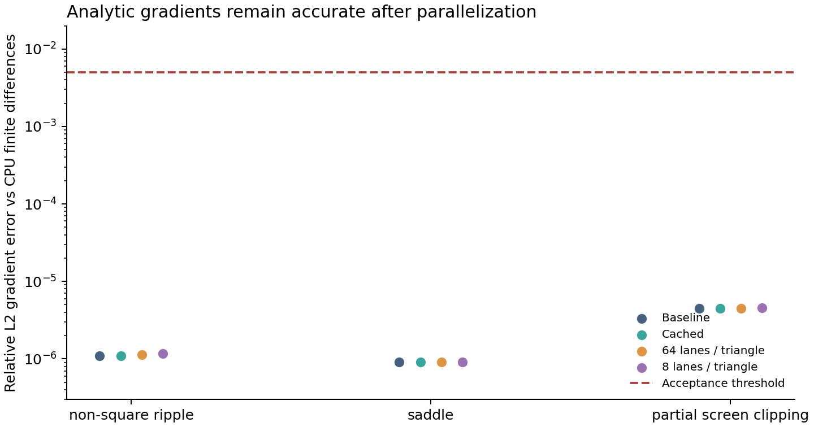
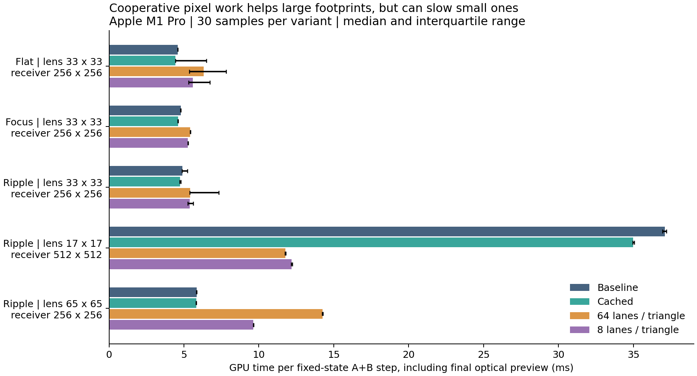
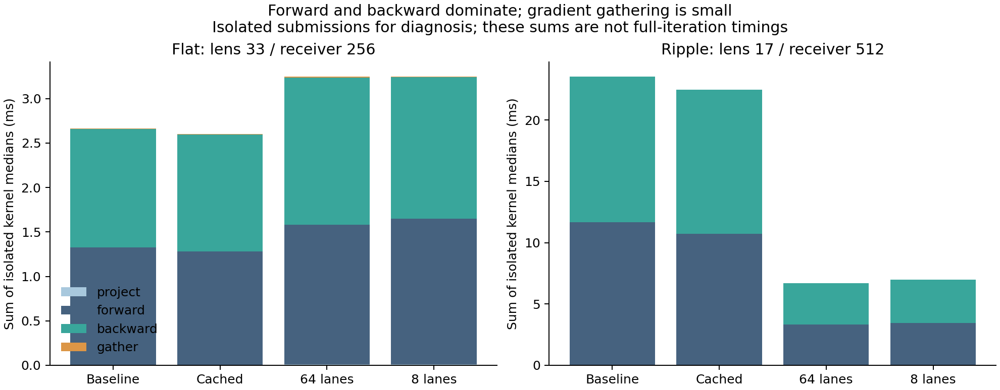

# A: Optics correctness and GPU performance

## Result

The forward and backward optics implementation passes independent CPU comparisons and finite-difference checks. Three optional implementations now accompany the baseline: cached footprints, 64-lane cooperative pixel work, and 8-lane pixel work. All preserve the existing `encode` / `encodeBackward` interface and beam/image layouts. The application still defaults to `baseline`; B, the drawing UI, and the renderer are unchanged.

On the tested Apple M1 Pro, cooperative work reduced a fixed-state A+B step from **37.10 ms to 11.77 ms (3.15x)** for a 17 x 17 lens and a 512 x 512 receiver. It was slower on the default 33 x 33 / 256 x 256 workloads. Caching provided a smaller improvement, around 3% on those default workloads. The small cache gains are median differences; the flat-scene timing distributions overlap, so they are not evidence of a robust universal speedup. These results support choosing kernels by workload, not replacing the baseline everywhere.

## What changed

| File | Responsibility |
| --- | --- |
| `src/optics/forward-model.ts` | Optional strategy selection and per-pass timestamp hooks; footprint storage and dispatch setup |
| `src/optics/optics.wgsl` | Optional storage/reuse of projected footprints and their derivatives |
| `src/optics/cooperative.wgsl` | Parallel pixel integration and workgroup reduction of triangle gradients |
| `check/a-study/` | Additional checks, repeatable benchmark, raw results, plotting script, and figures |
| `check/integration-check.ts` | Additional targets and selectable optical variants for full-solver tests |

`createForwardModel(device, initial, { strategy: 'cached' })` selects caching. The other choices are `'baseline'`, `'cooperative'` (64 lanes), and `'striped'` (8 lanes). The optional third argument belongs to A's factory; teammates' shared contracts do not change. Leave it absent to retain the baseline.

## Correctness

- Original suite: **28 assertions passed**, including CPU images, optical flux, CPU/GPU finite differences, same-encoder parameter preservation, zero-gradient overwrites, stale-result rejection, and a loss-reducing optical step.
- Extended suite: **12 scenarios x 4 implementations = 48 passing scenario/implementation combinations**. These cover a non-square ripple, saddle, surface near/at/behind the receiver, slopes just below/above the critical angle, nonfinite input, zero illumination, partial screen clipping, and an exact pixel boundary.
- For the below-critical case the exported beam remains active even though it misses the screen; the above-critical case has zero transmitted beam flux. Escaped light is not redistributed back onto the screen.
- Three regular configurations (ripple, saddle, and clipping) check every height derivative against independent CPU central differences. Maximum relative L2 gradient error was **4.52e-6**, below the **0.005** threshold. Exact topology changes and invalid geometries only check defined finite/inactive behavior, not differentiability.
- Five larger benchmark configurations x four implementations provide **20 image/gradient comparisons against the baseline**, with a relative L2 tolerance of **3e-4**. Parallel reduction and floating-point atomics can change rounding; bitwise identity is not required.
- Height-buffer aliasing and receiver-size changes are rejected. No GPU validation errors occurred.

Full optical optimization also passed the existing stopping, clearing, warm-restart, height-finiteness, and final-preview checks:

| Target | Kernel | Initial image loss | Loss after 3,000 updates |
| --- | --- | ---: | ---: |
| Circle | 8 lanes | 10.1608 | 0.4360 |
| Circle | 64 lanes | 10.1608 | 0.4469 |
| Ring | Baseline | 7.6695 | 0.4463 |
| Two circles | Baseline | 16.7655 | 0.6004 |

The circle tests additionally require outside power below 10% of incident power and received power above 95%. Lower loss on the other targets demonstrates progress, not a guarantee of an exact reconstruction.

## Measurement method

- Hardware: MacBook Pro, Apple M1 Pro, 8-core CPU, 16 GB memory; macOS 26.5.
- Browser: Chrome 156.0.0.0, headless, native Apple / Metal WebGPU adapter. Automated tests used `--enable-unsafe-webgpu`; no software adapter was selected.
- Date: November 7, 2026, America/New_York (raw UTC timestamp falls on November 8).
- Uses the optional WebGPU `timestamp-query` feature. Unsupported devices produce an explicit message rather than substituting CPU timing.
- **10 warmup evaluations, then 30 measured evaluations**, arranged in three blocks of ten. Implementation order rotates between blocks. Tables show medians; plots show the interquartile range. These are one-session measurements, not cross-device estimates.
- Fixed-state A+B measurement: every sample starts from the same surface, target, and fresh Adam state. It includes forward, B's filtered loss, backward, regularization, Adam update, and final optical preview. It is a matched kernel comparison, not a convergence benchmark or a measurement of a typical late training iteration.
- GPU step interval: from the first optical compute pass to the end of the final preview compute pass. Initial buffer resets/copy, display rendering, compilation, target drawing, and readback are outside that interval. `submitAndWaitMs` in the raw data separately includes CPU encoding/target setup and waiting, excluding timestamp readback.
- Isolated stage measurements submit and await each pass separately. On this Metal backend, submitting all phases together yielded overlapping pass intervals, even with separate submissions that were not awaited. Those exploratory numbers were rejected. Isolated phase sums include a different scheduling regime and must **not** be presented as the complete step time.
- Phase tests use a fixed synthetic incoming pixel gradient; full-step tests use B's actual loss gradient. Stage costs can consequently differ from their full-step context.

Timestamp definitions: [W3C WebGPU specification](https://www.w3.org/TR/webgpu/#timestamp-query).

## Performance results

Full A+B GPU span, including the final optical preview; milliseconds, lower is better:

| Surface | Lens vertices | Receiver pixels | Baseline | Cached | 64 lanes | 8 lanes |
| --- | --- | --- | ---: | ---: | ---: | ---: |
| Flat | 33 x 33 | 256 x 256 | 4.59 | 4.44 | 6.31 | 5.59 |
| Focus | 33 x 33 | 256 x 256 | 4.80 | 4.61 | 5.42 | 5.27 |
| Ripple | 33 x 33 | 256 x 256 | 4.89 | 4.73 | 5.42 | 5.38 |
| Ripple | 17 x 17 | 512 x 512 | 37.10 | 34.99 | 11.77 | 12.19 |
| Ripple | 65 x 65 | 256 x 256 | 5.85 | 5.82 | 14.25 | 9.63 |

Isolated default flat-surface baseline: forward **1.325 ms**, backward **1.333 ms**, gradient gather **0.0085 ms**. Forward and backward dominate this measurement. For the 17 x 17 / 512 x 512 ripple, baseline forward/backward were **11.670 / 11.875 ms**, versus **3.314 / 3.377 ms** for 64-lane cooperation, plus **0.0127 ms** for footprint preparation.

### Interpretation

The baseline assigns one triangle to one invocation and loops over its covered pixels. Large footprints create long per-invocation work. Cooperative variants distribute that pixel loop across a fixed lane team; their backward pass reduces partial derivatives in workgroup memory before the existing per-height gather. They preserve the same coverage integration and differentiation.

Small footprints do not provide enough pixel work to use all lanes. Extra footprint storage, preparation, workgroups, and reduction can outweigh the parallelism. Eight lanes reduce that overhead in some cases, but were not consistently fastest. Cached footprints remove repeated projection/differentiation in backward; the relatively small gains suggest that work elsewhere, including overlap integration, remains important.

These are workload-based explanations supported by timings, not hardware-counter measurements of atomic stalls or occupancy. Forward accumulation still uses global compare-and-swap float atomics. Receiver-tile binning/local accumulation has **not** been implemented or measured in this study. It remains a separate experiment; the implemented load-balancing experiment is lane cooperation within each triangle.

## Reproduce

1. From the project root run `npm ci` if dependencies are missing, then `npm run dev`.
2. Open `/check/optics-check.html` for the original correctness checks.
3. Open `/check/a-study/?checks-only` for the 48 extended combinations.
4. Open `/check/a-study/` for all checks and the benchmark. Keep other GPU-heavy applications and tabs idle. The page reports progress and provides a raw JSON download.
5. Open `/check/integration-check.html?shape=circle&strategy=cooperative` for a full optimized-kernel circle run. `strategy=striped`, `shape=ring`, and `shape=two-circles` are also supported. Omit `strategy` to use the baseline.
6. Regenerate charts from saved data with `python3 check/a-study/plot_results.py` (requires NumPy and Matplotlib; application dependencies are unchanged).

Saved evidence: [performance JSON](a-study/results/performance.json), [summary CSV](a-study/results/summary.csv), [every timing sample](a-study/results/samples.csv), [extended checks](a-study/results/extended.json), [original checks](a-study/results/legacy.json), and [integration runs](a-study/results/integration.json).

## Remaining scope

The default baseline remains deliberately available. There is no claim of real-time convergence for arbitrary drawings, GPU speedups on NVIDIA hardware, or successful fabrication of a physical lens. Workgroup dispatch and storage are checked against device limits. Cached results have the same lifetime rule as existing outputs: consume backward before overwriting the input heights or reusable forward state.
